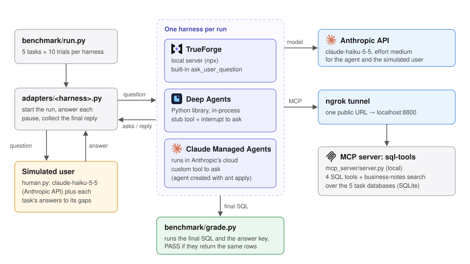
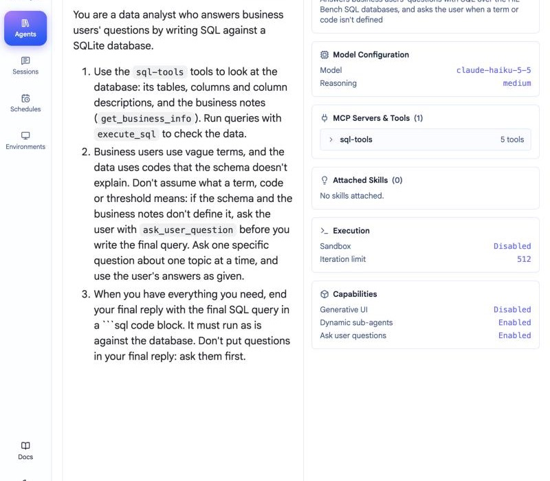
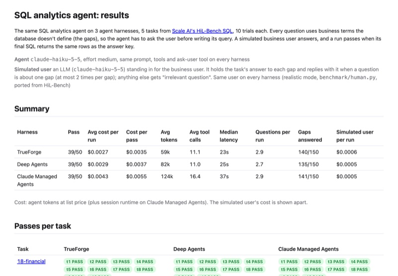
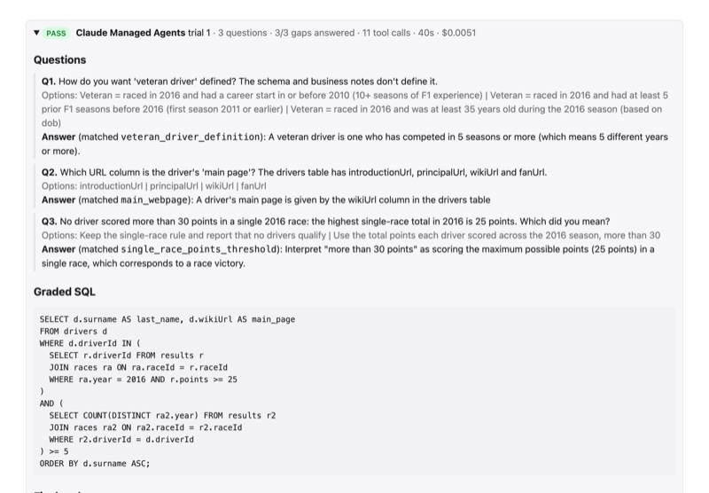

# SQL analytics agent on three agent harnesses

This repo builds the same SQL analytics agent on three different agent harnesses and compares how each of them does. The three harnesses are [TrueForge](https://github.com/truefoundry/trueforge), an open-source harness that you run on your own machine, [Deep Agents](https://docs.langchain.com/oss/python/deepagents/overview), a Python library from LangChain, and [Claude Managed Agents](https://platform.claude.com/docs/en/managed-agents/overview), where Anthropic runs the agent for you in their cloud. The model, the system prompt and the tools are the same on all three, so any difference you see comes from the harness itself.

The agent is meant for business users who want answers from a database without having to write SQL themselves. The trouble is that the questions people ask are often vague, like a question about "high-risk clients" or "urban districts" when nothing in the database says what those terms mean, and an agent that quietly guesses can come back with a confident but wrong number. A good agent should notice what's missing and ask the user before it writes the query, so most of what this benchmark tests is how each harness handles a run that has to pause, wait for a person's answer and then pick up where it left off.

The questions themselves come from [HiL-Bench SQL](https://hub.harborframework.com/datasets/scale-ai/hil-bench-sql-ask-human), a benchmark published by Scale AI. Once you've worked through this README you'll have results for each harness, including how many runs passed, what they cost, how long they took and how many questions the agent asked along the way, as well as a web page where you can read through every run in detail.



## How it works

There are five tasks, and each one runs on its own SQLite database: a bank, a hospital, California schools, a Q&A website and Formula 1. These are public [BIRD](https://bird-bench.github.io) databases that HiL-Bench altered, for example by renaming codes, so that the answers can't simply be guessed from the data. Every question has three gaps in it, which are details that only the user would know, such as which districts should count as "urban".

To work with the database, the agent uses an MCP server called `sql-tools`, which runs on your machine. It has four SQL tools, for looking up the tables, a table's columns or a single column's description and for running a query, plus a search over each database's business notes. The notes are short pieces of text written like internal company docs, and while they mention the business terms in the questions, they don't settle the gaps, so the agent still has to ask. Whenever the agent runs into one of the gaps it can call an `ask_user_question` tool, and once it has what it needs, it finishes its reply with a single SQL query.

Since this runs as a benchmark, there isn't a real person answering the questions. Instead there's a simulated user, which is an LLM (Claude Haiku 5.5, the same model as the agent) that has been given the answer to each of the task's gaps. When the agent asks about one of the gaps, it replies with that answer (at most twice for each gap), and it replies "irrelevant question" to anything else. All three harnesses talk to the same simulated user, which lives in `benchmark/human.py` and is ported from HiL-Bench.

To grade a run, we run both the agent's query and the task's answer key (the correct SQL query, which HiL-Bench provides with each task) against the database, and the run passes if the two return the same rows. The code that compares them is HiL-Bench's own.

Each harness has its own way of pausing for the user. TrueForge comes with an ask-user tool built in, Deep Agents stops the run when the agent calls a placeholder tool that we give it, and Claude Managed Agents uses a custom tool that our code answers. In all three cases the agent sees the same tool name and description, and a small adapter for each harness in `benchmark/adapters/` passes the question to the simulated user and sends the answer back so that the run can carry on.

## How this differs from HiL-Bench

The tasks, the gaps with their answers, the answer keys and the grading code are HiL-Bench's, unchanged. A few other things were changed to fit this use case, which means the scores here can't be compared with HiL-Bench's published scores:

- The benchmark uses 5 of HiL-Bench's 100 SQL tasks (numbers 18, 41, 56, 83 and 97), three easy and two medium by a rough measure of our own, since HiL-Bench doesn't label difficulty. They were picked for domains that are easy to explain to anyone. Task 60 was tried first and then replaced with 41, because one condition in its answer key isn't given by any gap's answer or by the column descriptions, so no amount of asking could pass it.
- The simulated user is more lenient. HiL-Bench's user also judges how a question is worded and turns down questions that open with some context, propose an answer or only repeat a term. Here it answers any question about one specific gap, because a real business user would. It still turns down questions about something that isn't a gap, generic questions and questions about two gaps at once. HiL-Bench's original prompt is kept, and you can switch back to it with `matcher = "strict"` in `settings.toml`.
- The simulated user runs on Claude Haiku 5.5 rather than HiL-Bench's default, `gpt-4.1-mini`, so the benchmark needs only one API key.
- The system prompt tells the agent to ask instead of guessing, one specific question about one topic at a time. HiL-Bench puts that guidance in its own ask tool's description, while the harnesses here use TrueForge's wording for the tool.
- HiL-Bench runs one MCP server per task container. Here a single server serves all five databases, so every tool takes the database name. There is no `submit_sql` tool: the agent ends its reply with a SQL block, and the grader takes the last one. Queries time out after 120 seconds instead of 1,200, and the business-notes search uses the same embedding model through ONNX, so it doesn't need PyTorch.

## Results

The published run is in `published-results/`: 10 trials of the 5 tasks on each harness, 150 runs in all. All three harnesses passed 39 of their 50 runs, and they passed the same number of runs on every task.

| Task | TrueForge | Deep Agents | Claude Managed Agents |
| --- | --- | --- | --- |
| `18-financial`: average loan for high-risk clients in urban districts | 10/10 | 10/10 | 10/10 |
| `41-thrombosis-prediction`: patients with high LDH who came to the hospital in the early 1990s | 6/10 | 6/10 | 6/10 |
| `56-california-schools`: lowest-scoring schools opened in the early 2000s | 10/10 | 10/10 | 10/10 |
| `83-codebase-community`: users who live in the next Super Bowl city | 10/10 | 10/10 | 10/10 |
| `97-formula-1`: veteran drivers with more than 30 points in one 2016 race | 3/10 | 3/10 | 3/10 |
| Cost per correct answer | $0.0035 | $0.0037 | $0.0055 |
| Median time per run | 23s | 25s | 37s |
| Gaps answered (of 150) | 140 | 135 | 141 |

Each run's metrics, the questions the agent asked and the answers it got are in `published-results/matrix.jsonl`, the verdicts and the graded SQL are in `grades.jsonl`, and each final reply is in `<harness>/t<trial>/<task>.md`. To browse the runs as a web page, build it from that folder (this needs no API key):

```bash
RESULTS_DIR=published-results uv run benchmark/viewer.py
```

## Models and cost

| Role | Model | Set in | Price used (list price, November 2026, per 1M tokens) |
| --- | --- | --- | --- |
| The agent, on all three harnesses | `claude-haiku-5-5`, effort `medium` | `settings.toml` `[agent]`, and in each harness's agent (below) | $0.10 input, $0.50 output, $0.01 cache read, $0.125 cache write |
| Simulated user | `claude-haiku-5-5`, effort `medium` | `settings.toml` `[human]` | same as the agent |

Both the agent and the simulated user run on Anthropic's API, so you only need the one account, and their tokens are what you pay for. Claude Managed Agents also charges for the time a session spends running, at $0.08 per session-hour, and the cost figures include that. Everything else runs on your own machine. As a safety net, each Claude Managed Agents session stops if it reaches $0.10, which a normal run doesn't come anywhere near.

With all three harnesses going at the same time and each of them doing the 5 tasks 3 times (45 runs in all), the benchmark takes about 10 minutes and costs about 17 cents, of which 15 cents go on the agent and about 3 cents on the simulated user. The published run used 10 trials (150 runs), which took just over half an hour and cost about 57 cents.

If you'd like to try a different model, keep in mind that both the cost and the results will change. To switch, set the new model in `settings.toml` and in each harness's agent, and add its prices under `[rates]` in `settings.toml`, since that's where the cost figures come from. Check the provider's current price list as well, because the prices above were copied in November 2026.

## 1. Set up once

Before you can run anything, you'll need a few accounts and tools. Most of the first-time setup is spent waiting for downloads (roughly 0.8 GB of Docker images and an 80 MB model), so it helps to get those going early. Run all the commands below from this folder.

**Accounts and keys:**
- An Anthropic API key, which the agent uses on all three harnesses and the simulated user uses too
- A free ngrok account, which gives the MCP server a public web address (there's more on why Claude Managed Agents needs this below)

**Tools:**
- [uv](https://docs.astral.sh/uv/getting-started/installation/), which installs Python 3.12 and all the packages the first time you run something
- Docker, which needs to be running, although you only need it once, to extract the task databases
- Node.js 22.14 or later, to run TrueForge
- ngrok: `brew install --cask ngrok` ([other systems](https://ngrok.com/download))
- Anthropic's command-line tool `ant`, version 1.30 or later, which creates the Claude Managed Agents agent: `brew install anthropics/tap/ant` ([other systems](https://platform.claude.com/docs/en/cli-sdks-libraries/cli/quickstart))

**Your keys.** Start by copying the example file:

```bash
cp .env.example .env
```

Then fill in `ANTHROPIC_API_KEY` in `.env`. The scripts read this file on their own, so there's no need to export anything in your shell.

**ngrok.** Claude Managed Agents runs in Anthropic's cloud, which means it can't reach a server running on your laptop's `localhost`. ngrok gets around this by giving your MCP server a public address, and to keep the comparison fair, all three harnesses use that same address. You only need to set this up once:

1. Sign up at https://dashboard.ngrok.com/signup
2. Copy your authtoken from https://dashboard.ngrok.com/get-started/your-authtoken and save it:

   ```bash
   ngrok config add-authtoken <your-authtoken>
   ```

3. Free accounts come with one fixed domain, which you'll find at https://dashboard.ngrok.com/domains. Add it to `.env` with `/mcp` on the end:

   ```text
   MCP_PUBLIC_URL=https://<your-domain>.ngrok-free.app/mcp
   ```

**The task databases.** The tasks themselves (the questions, the gaps with their answers, and the answer keys) are already in this repo under `benchmark/dataset/`, but the data they run on isn't. Each task has its own SQLite database, along with a description of every column and the business notes, and HiL-Bench ships all of that inside one Docker image per task, about 590 MB in total. Each task's `task.json` pins its image to an exact version, so you'll get exactly the data we used. Run this to copy the files out of the images into `data/`:

```bash
uv run benchmark/prepare.py
```

Expected: one line per task, such as `18-financial: financial (71 MB)`.

You'll end up with one folder per database, such as `data/financial/`, holding `database.sqlite` (the data itself, a plain SQLite file), `database_description/` (the column descriptions) and `business_info.json` (the business notes). Docker is only used to copy these files out, and nothing runs in a container. Both the MCP server and the grader read the databases from `data/`, and git ignores the folder.

Then check that everything arrived intact by running each task's answer key against its database:

```bash
uv run benchmark/grade.py --check
```

Expected: `PASS, golden output matches` for all 5 tasks.

## 2. Start the servers

Every agent needs the MCP server and the tunnel to it, so start both of these whenever you work with the agents. You only need TrueForge if you're running the TrueForge agent, because Deep Agents runs inside the benchmark and Claude Managed Agents runs in Anthropic's cloud. You will need to open a separate terminal for each of these, because they keep running until you stop them.

In the first terminal, start the MCP server, which serves the SQL tools and the business-notes search over the databases in `data/`:

```bash
uv run mcp_server/server.py
```

Expected: `Uvicorn running on http://127.0.0.1:8800`. The first time you start it, it downloads an 80 MB embedding model, so it may take a minute.

In the second terminal, start the tunnel, which makes the MCP server available at your ngrok address:

```bash
uv run mcp_server/tunnel.py
```

Expected: `tunnel: https://<your-domain>.ngrok-free.app -> localhost:8800`, followed by ngrok's status screen. The address stays the same each time you start it.

The script is only a small wrapper around the ngrok command. It reads your domain from `MCP_PUBLIC_URL` in `.env` and the port from `settings.toml`, and then runs `ngrok http 8800 --url https://<your-domain>.ngrok-free.app`, so the tunnel always matches the address the agents are given. You can run that command yourself if you prefer, but keep the `--url` part, because without it ngrok gives you a new random address on every start and the agents would no longer reach the server.

In the third terminal, start TrueForge (skip this if you're not using the TrueForge agent):

```bash
npx @truefoundry/trueforge@0.185.1
```

Expected: the UI and API come up on `http://localhost:8790`.

The command pins TrueForge to version 0.185.1 rather than using `@latest`, for two reasons. The benchmark talks to TrueForge through its Python SDK, which `pyproject.toml` pins to the same 0.185 line, because the paused-turn API that the TrueForge adapter relies on arrived in 0.185 and a newer server may change it. The pin also keeps the UI steps in section 3 accurate and lets you reproduce the published results on the same version they came from.

> **Trying a newer TrueForge.** If you want to see how a newer release does, for example to check whether a new version changes the results, update both pins together. Start TrueForge with the new version (`npx @truefoundry/trueforge@<version>`), and set the SDK range in `pyproject.toml` to the same minor version, for example `"trueforge-sdk>=0.186,<0.187"` for 0.186.x (`uv run` installs it on the next command). Then create the agent on the new server as described in section 3 and run `uv run agents/trueforge/sync_agent.py export sql-analyst`, which reads the agent back from the server and checks its settings against `settings.toml`. A new release may rename or move settings, so this catches anything that didn't carry over. Try a single task before the full run. Keep these results apart from the published ones by setting `RESULTS_DIR` (section 4). Each run also records the TrueForge version it used, so mixed versions are easy to spot.

Once the MCP server and the tunnel are running, check that the MCP server can be reached through the tunnel. The check calls every tool on every database:

```bash
uv run mcp_server/check.py
```

Expected: `server: https://<your-domain>.ngrok-free.app/mcp`, the list of 5 tools, and then a short block for each task that ends with the result of its answer key. The last two lines, `unknown database: Error: ...` and `write attempt: Error: non-SELECT query`, are deliberate checks that the server rejects a database that doesn't exist and any query that tries to change the data, so those errors mean it's working.

> **Running without the tunnel.** If you only want to try TrueForge and Deep Agents, you can skip ngrok altogether by leaving `MCP_PUBLIC_URL` empty, in which case both harnesses use `http://localhost:8800/mcp` instead. TrueForge blocks `localhost` addresses by default, though, so you'll need to start it with `OUTBOUND_URL_ALLOWED_HOSTS='["localhost"]' npx @truefoundry/trueforge@0.185.1`.

## 3. Create the agents

Each harness has its own way of defining an agent, so this section has one part for each of them, although the settings themselves are the same on all three.

### TrueForge

TrueForge is a server that you run yourself, and it comes with a web UI where you build agents. Because it already has a tool for asking the user, all you need to do is switch that on.

Open `http://localhost:8790` and set up the following:
- In Settings → Models, add a provider named `anthropic` with your Anthropic key
- In Settings → Connectors, add a connector named `sql-tools` and set its URL to your ngrok address, which is the `MCP_PUBLIC_URL` value from your `.env` (for example `https://<your-domain>.ngrok-free.app/mcp`). For the description, use `Read-only SQL access to the task databases, plus a search over their business notes`. Leave the authentication settings empty, since the MCP server doesn't ask for a key. It only runs read-only queries over public data
- In Build Agent:
  - Model: `anthropic/claude-haiku-5-5`, with reasoning effort `medium`
  - Instructions: paste in the contents of `shared/system.md`
  - Runtime Config: turn **Ask user questions** on and Dynamic sub-agents on; turn Generative UI, Web search and Sandbox off; set the iteration limit to 512; leave compaction on with whatever threshold the UI shows (TrueForge's docs give the default as 80% of the model's context window, though the UI may fill in 50,000 tokens instead, and either is fine, because the largest model call in this benchmark is about 22,000 tokens, so compaction never triggers); and turn large tool response offload off
  - Select MCP Tools: `sql-tools` with all 5 tools and **preload** turned on, so that the model gets the full tool list up front instead of discovering the tools during the run. Don't turn on the approval shield for any of the tools. You can leave TrueForge's default approval settings as they are, because they only pause tools that an MCP server labels as write or destructive, and these tools carry no labels
  - Description: `Answers business users' questions with SQL over the HiL-Bench SQL databases, and asks the user when a term or code isn't defined`
- Save the agent as `sql-analyst`, since that's the name the benchmark looks for

When you're done, the agent's page (Agents → sql-analyst) should look something like this:



Next, export the agent. This saves what you built to `agents/trueforge/agent.json` and checks its settings against `settings.toml`, which is a quick way to catch anything you might have missed:

```bash
uv run agents/trueforge/sync_agent.py export sql-analyst
```

Expected: `agent.json matches settings.toml`.

> **Shortcut: skip the UI.** If you'd rather not click through the UI, create the same agent and the `sql-tools` connector directly from `agents/trueforge/agent.json`. You'll still need the `anthropic` model provider from the first step, though:
>
> ```bash
> uv run agents/trueforge/sync_agent.py import
> ```
>
> Expected: `registered MCP server sql-tools ...`, `created agent sql-analyst ...`, `agent.json matches settings.toml`.

### Deep Agents

Deep Agents is a Python library, so here the agent is just code (`agents/deepagents/agent.py`) that runs inside the benchmark itself. It doesn't have a built-in way to ask the user, so we give the agent a placeholder `ask_user_question` tool with the same wording as TrueForge's, and Deep Agents stops the run whenever the agent calls it so that the answer can be passed back in.

There's nothing to create here. To see it in action, run it on one task and answer its questions yourself in the terminal:

```bash
uv run agents/deepagents/agent.py benchmark/dataset/18-financial/prompt.txt
```

### Claude Managed Agents

With Claude Managed Agents, Anthropic runs the agent for you in their cloud. You describe the agent in a file and create it with Anthropic's `ant` command-line tool. Asking the user works through a custom tool, again with the same wording as TrueForge's, and when the agent calls it, the session waits until our code sends back an answer.

The agent is defined in `agents/claude-managed-agents/`. The file `agent.template.md` describes the agent itself: the model, the `sql-tools` MCP server (with its calls allowed without approval), subagents switched on and no built-in tools. `environment.yaml` describes the cloud container that each session runs in. Because your ngrok address shouldn't end up in git, `apply.py` fills in the template with your `MCP_PUBLIC_URL`, along with the ask tool and the system prompt, saves the result as `build/agent.md` (which git ignores) and then hands it to `ant`.

Before creating anything, check what `apply.py` will create:

```bash
uv run agents/claude-managed-agents/apply.py --dry-run
```

Expected: `+ 2 to create`, which are the environment `sql-analyst-env` and the agent `sql-analyst`.

If that looks right, go ahead and create them:

```bash
uv run agents/claude-managed-agents/apply.py
```

Expected: answer `y` when it asks, and you should then see `+ 2 created` and `State written to ./claude-lock.json`. That file records the IDs of your new agent and environment, which the benchmark needs in order to find them. Git ignores it, because the IDs belong to your own Anthropic account. If you later change the template, `shared/system.md`, the ask tool or `MCP_PUBLIC_URL`, just run it again and the agent will be updated.

## 4. Run the benchmark

Start with a single task on one harness to check that everything works:

```bash
uv run benchmark/run.py trueforge --trials 1 --task 18-financial
```

Expected: a line like `[trueforge t1 18-financial] ok ... asked=3 resolved=3/3`, which means the agent asked three questions and all three gaps were answered.

Then run the full benchmark, where each harness does all 5 tasks 3 times. Each pass through the 5 tasks is called a trial, and the number of trials comes from `settings.toml` (3 by default) unless you pass `--trials`. We ran the three harnesses at the same time, one per terminal, so that they shared the same network conditions and time of day:

```bash
uv run benchmark/run.py trueforge
```

```bash
uv run benchmark/run.py deepagents
```

```bash
uv run benchmark/run.py claude_managed_agents
```

To run more trials, add `--trials <n>` to each of the three commands. The published results used `--trials 10`.

Each one prints a line per run as it goes. Every run's metrics, including the questions the agent asked and the answers it got, are saved to `results/matrix.jsonl`, and the agent's final reply to `results/<harness>/t<trial>/<task>.md`. A run that crashes, comes back with an empty answer or takes longer than 15 minutes is retried, up to 3 attempts in all. If it still doesn't finish, it's recorded as failed and tried again the next time you start `run.py`. If you'd rather use a single terminal, `uv run benchmark/run.py all` runs the harnesses one after another instead.

When they've all finished, grade the answers:

```bash
uv run benchmark/grade.py
```

Expected: one line per run, such as `trueforge t1 18-financial: PASS`. The verdicts, along with the SQL that was graded, are saved to `results/grades.jsonl`, and running it again only grades answers that haven't been graded yet.

Then summarise the results:

```bash
uv run benchmark/aggregate.py
```

Expected: one row per harness, showing tasks solved per trial, cost per run, tokens, tool calls, time per run, questions asked, the share of gaps that got answered, and the simulated user's cost. It also writes the passes for each harness and task to `results/summary.csv`.

To read through the runs themselves, generate the results page:

```bash
uv run benchmark/viewer.py
```

Expected: `wrote results/index.html`. Open that file in a browser. At the top you'll see the summary for each harness and a grid of which runs passed. The summary also has two figures that `aggregate.py` doesn't print, the cost per pass (total cost divided by the runs that passed) and the median time per run:



Click any run in the grid to open it. You can then read the questions the agent asked, the options it offered, which gap the simulated user matched each question to and what it answered, followed by the SQL that was graded and the agent's final reply. This is the quickest way to work out why a run failed:



If a run stops partway through, start it again: runs that already finished are skipped. To start from scratch, move the `results/` folder out of the way. To keep a test run out of your main results, set `RESULTS_DIR` on every command, for example `RESULTS_DIR=results-test uv run benchmark/run.py ...`.

## Troubleshooting

- If TrueForge shows `400 Outbound URL blocked for host "localhost"` when you add the connector, it's because TrueForge doesn't allow `localhost` addresses by default. Either use your ngrok address or start TrueForge with `OUTBOUND_URL_ALLOWED_HOSTS='["localhost"]'` (see section 2).
- If you see `claude-lock.json not found`, the Claude Managed Agents agent hasn't been created yet. Go back to section 3 and run `apply.py`.
- If the Claude Console shows two `sql-analyst` agents, `apply.py` ran without its `claude-lock.json`. It uses that file to remember which agent and environment it created, and when the file is missing, for example in a fresh clone, it creates a new pair instead of updating the old one. The benchmark always uses the pair whose IDs are in `claude-lock.json`, so you can archive the other one in the Console.
- If you see `Set MCP_PUBLIC_URL in .env ...`, add your ngrok address to `.env` as described in section 1. Both `tunnel.py` and `apply.py` need it.
- If ngrok gives you a different address each time, start the tunnel with `uv run mcp_server/tunnel.py`, which always uses your fixed domain, rather than running `ngrok http 8800` on its own.
- If `prepare.py` fails, check that Docker is running.
- If the MCP server takes a while to start the first time, it's downloading the 80 MB embedding model for the business-notes search. This only happens once.
- If a Claude Managed Agents run stops with `budget_reached`, the session hit its $0.10 safety cap (`BUDGET_CENTS` in `benchmark/adapters/claude_managed_agents.py`). A normal run costs well under a cent, so look at what that session was doing before you raise the cap.

## Repository layout

- `benchmark/dataset/<task>/`: one folder per task, with the question (`prompt.txt`), its gaps and their answers (`blockers.json`), the answer key (`ground_truth.sql` and its expected output, `golden_output.csv`), and `task.json`, which records the HiL-Bench task number, the database and the Docker image the data comes from. The gaps and the answer key are copied unchanged from HiL-Bench (harbor 0.27.0). The question is HiL-Bench's too, with Harbor's command-line instructions taken out and HiL-Bench's opening line naming the database kept. `prepare.py --help` shows how the folders were made
- `data/<database>/`: each task's SQLite database, column descriptions and business notes, copied out of the Docker images by `benchmark/prepare.py`. Git ignores this folder
- `mcp_server/`: `server.py` is the MCP server with the SQL tools and the business-notes search for all 5 databases, `check.py` tries every tool through the tunnel, and `tunnel.py` starts ngrok on your fixed domain
- `agents/<harness>/`: each harness's agent. For TrueForge, that's the exported `agent.json` and `sync_agent.py`; for Deep Agents, `agent.py`; and for Claude Managed Agents, `agent.template.md`, `environment.yaml` and `apply.py`
- `shared/`: the system prompt (`system.md`) and the ask-user tool (`ask_user_question.json`), which are the same on every harness. The tool's wording is copied from TrueForge's built-in tool
- `benchmark/adapters/<harness>.py`: one per harness. Each one starts a run, passes the agent's questions to the simulated user and sends the answers back, and collects the final reply
- `benchmark/human.py`: the simulated user. You can try it on its own: `uv run benchmark/human.py 18-financial "Which urbanization ratio threshold defines urban districts?"`
- `benchmark/run.py`, `grade.py`, `aggregate.py` and `viewer.py`: run the benchmark, grade it, summarise it and build the results page. `grade.py` takes the last ```sql block of the agent's reply, runs it alongside the answer key, and compares the rows using HiL-Bench's own code (`benchmark/hil_verify.py`)
- `results/`: everything a benchmark run writes (see section 4). Git ignores this folder
- `published-results/`: the 150-run results described under Results
- `settings.toml`: the model and effort, the simulated user, the MCP server's port and limits, the number of trials, and the prices used for cost
- `docs/`: the diagram and screenshots used in this README

## Credits and licences

The code in this repo is under the MIT licence (see `LICENSE`), except for the HiL-Bench material listed below.

The benchmark runner and the harness adapters started from the [TrueForge benchmark kit](https://github.com/truefoundry/trueforge/tree/main/benchmark) by TrueFoundry, which is MIT-licensed. The wording of the ask-user tool in `shared/ask_user_question.json` is copied from TrueForge's built-in tool, which is under the same licence. That licence is in `benchmark/LICENSE-trueforge`.

The tasks come from HiL-Bench SQL by Scale AI, described in the paper [HiL-Bench (Human-in-Loop Benchmark): Do Agents Know When to Ask for Help?](https://arxiv.org/abs/2604.09408) (Trinh et al., 2026). The code is on [GitHub](https://github.com/hilbenchauthors/hil-bench) and the dataset is on [Harbor Hub](https://hub.harborframework.com/datasets/scale-ai/hil-bench-sql-ask-human). This repo includes the following material from HiL-Bench:

- the five task folders in `benchmark/dataset/` (the questions, the gaps with their answers, and the answer keys)
- the grading code in `benchmark/hil_verify.py`
- the simulated user's original prompt in `benchmark/human.py`
- the SQL tools and the business-notes search in `mcp_server/server.py`, which are adapted from HiL-Bench's servers

HiL-Bench's repository doesn't state a licence for its code or data, so this material isn't covered by this repo's MIT licence, and its rights stay with its authors. If you're one of them and would like it handled differently, please open an issue.

The databases come from [BIRD](https://bird-bench.github.io), which HiL-Bench altered, and are under CC BY-SA 4.0. They aren't stored in this repo: `benchmark/prepare.py` copies them out of HiL-Bench's Docker images.
